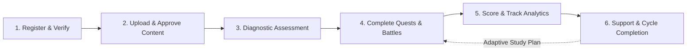

# BoardQuest | MedTech Licensure Review System

> **An AI-Gamified Licensure Examination Preparation Platform**  
> Designed for Medical Technology Examinees at Southwestern University PHINMA  
> **Project Code:** `SWU-001` | **Document Version:** `1.0.1` | **Effective Date:** October 2026

[](https://nextjs.org/)
[](https://www.typescriptlang.org/)
[](https://tailwindcss.com/)
[](https://www.prisma.io/)
[](https://www.mongodb.com/)
[](https://ai.google.dev/)
[-green?style=flat-square)](#-data-privacy-security--compliance)

---

## 📑 Table of Contents
1. [Overview & Project Context](#-overview--project-context)
2. [Project Metadata & Key Contacts](#-project-metadata--key-contacts)
3. [System Architecture & Technology Stack](#-system-architecture--technology-stack)
4. [User Experience, Feedback & Prioritization](#-user-experience-feedback--prioritization)
5. [Core Functional Modules & Business Flow](#-core-functional-modules--business-flow)
6. [Roles, Access Control & Permission Matrix](#-roles-access-control--permission-matrix)
7. [Technical Specifications Needed for Users](#-technical-specifications-needed-for-users)
8. [Software Engineering & Governance Standards](#-software-engineering--governance-standards)
9. [Data Privacy, Security & Compliance (RA 10173)](#-data-privacy-security--compliance)
10. [Incident Escalation & Support SLA Matrix](#-incident-escalation--support-sla-matrix)
11. [Acceptable Use Policy (AUP) Summary](#-acceptable-use-policy-aup-summary)
12. [Bring Your Own Device (BYOD) Policy Summary](#-bring-your-own-device-byod-policy-summary)
13. [Timeline, Budget & Risk Management](#-timeline-budget--risk-management)
14. [Local Setup & Development Guide](#-local-setup--development-guide)
15. [Documentation Directory & References](#-documentation-directory--references)

---

## 🎯 Overview & Project Context

Preparation for the **Medical Technologist Licensure Examination (MTLE)** at Southwestern University PHINMA in Cebu City, Philippines, demands intensive academic dedication—with graduating interns and reviewees frequently studying 5 to 7 hours daily. Traditional preparation methodologies rely heavily on passive memorization and static question banks, inducing cognitive fatigue, study burnout, and high test anxiety without fostering diagnostic clinical reasoning.

**BoardQuest** replaces traditional rote learning with an interactive, adaptive, AI-gamified review journey across all six official laboratory science disciplines:
1. **Clinical Chemistry**
2. **Microbiology**
3. **Hematology**
4. **Clinical Microscopy & Parasitology**
5. **Immunology & Serology and Immunohematology (Blood Banking)**
6. **Histopathology and Medical Technology Laws**

### Core Purpose for BoardQuest Users (Aspirants)
While the platform provides robust back-office tools for faculty question creation and institutional analytics, **this repository is specifically focused on the BoardQuest Examinee / Aspirant experience**:
- ⚔️ **Quest Arena:** High-engagement visual battle simulations where examinees tackle board-style questions across an archipelago of medical domains.
- 🔄 **Dual Testing Pathways:** 
  - **Learning Mode:** Instant, interactive AI tutor explanations breaking down why an answer is correct and dissecting distractors after every attempt.
  - **Test Mode:** High-fidelity exam simulation adhering to official time constraints and score withholdings to build stamina and reduce anxiety.
- 🧠 **AI-Synthesized Clinical Scenarios:** Generative AI reformulates static recall questions into multi-step, scenario-based clinical problems that mirror actual licensure examination questions.
- 📈 **Real-Time Diagnostic Radar Charts & Board Readiness Index:** Live visual skill breakdown across all 6 domains, calculating an official readiness index modeled on Philippine regulatory grading rules (minimum **75% General Weighted Average** with **no domain below 50%**).
- 🏆 **Gamified Habit Formation:** Experience Points (XP), Expedition Levels, milestone badges, and streak trackers designed to mitigate study procrastination.

---

## 👥 Project Metadata & Key Contacts

**Institutional Partner:** Southwestern University PHINMA — College of Medical Technology  
**Project Code:** `SWU-001` | **Manuscript Document:** Version `1.0.1`

| Name | Role / Title | Email | Phone Number |
| :--- | :--- | :--- | :--- |
| **Louie Dela Cerna Remotigue, MD** | Dean, College of Medical Technology (Client) | `jdremotigue.swu@phinmaed.com` | +63 919 007 2129 |
| **Berndt Dennis F. Canaya** | Main Programmer | `befa.canayaa.swu@phinmaed.com` | +63 960 631 7196 |
| **Ethan Gabriel T. Rolloque** | Programmer | `etto.rolloque.swu@phinmaed.com` | +63 939 365 4549 |
| **Arl Jacob C. Necesario** | Technical Support | `arca.necesario.swu@phinmaed.com` | +63 915 016 8825 |
| **Lance Keith I. Fajardo** | UI/UX Designer | `lain.fajardo.swu@phinmaed.com` | +63 951 785 3001 |

---

## 🏗️ System Architecture & Technology Stack

BoardQuest is engineered as a decoupled, multi-tier web ecosystem:

```
[ User Web Clients: Examinees, Faculty, Admins ]
                      │ (HTTPS / WSS)
                      ▼
               [ Cloudflare DNS & WAF ]
                      │
        ┌─────────────┴─────────────┐
        ▼                           ▼
[ Vercel Frontend ]         [ Render Central API ]
(Next.js, React, Vite,       (Node.js, Express.js, TypeScript,
 Tailwind CSS, Radix UI)     Prisma ORM, Agenda Job Queue)
                                    │
    ┌───────────────────────────────┼───────────────────────────────┐
    ▼                               ▼                               ▼
[ MongoDB Atlas ]          [ Supabase Storage ]            [ External Integrations ]
(Document Database)        (Laboratory Micrographs,        • Google Gemini API
                            Question Diagrams, Avatars)     • Pusher Channels (Realtime)
                                                           • Resend (Scorecards & Email)
                                                           • n8n (AI Workflows)
```

| Layer | Technology | Operational Function |
| :--- | :--- | :--- |
| **Frontend Framework** | **React / Next.js with Vite** | High-performance interactive UI, SSR/SSG rendering, dynamic screen updates without full page reloads. |
| **Visual Styling** | **Tailwind CSS & Radix UI** | Responsive mobile-first styling system, standardized design tokens, accessible UI components. |
| **Backend Runtime** | **Node.js & Express.js** | Stateless RESTful API, authentication middleware, exam scoring calculations, and background task processing. |
| **Type Safety** | **TypeScript** | Strict compile-time data validation across all modules to prevent runtime defects. |
| **Database & ORM** | **MongoDB Atlas & Prisma** | Managed cloud document database with high-availability clustering and a single unified Prisma schema blueprint. |
| **Media Cloud Storage** | **Supabase Storage** | Fast worldwide CDN delivery for high-resolution medical micrographs, histology slides, and profile pictures. |
| **Artificial Intelligence** | **Google Gemini API** | Automated clinical question synthesizer, scenario paraphraser, and personalized rationale generation. |
| **Realtime Messaging** | **Pusher Channels** | Low-latency WebSockets for instant leaderboard updates, approval notifications, and exam events. |
| **Transactional Email** | **Resend** | Secure transmission of account invitations, password recovery links, and digital student scorecards. |
| **Background Scheduler** | **Agenda** | MongoDB-backed job queue managing daily streak evaluations, bulk imports, and study reminder dispatches. |
| **Edge & Infrastructure** | **Cloudflare & Docker** | DNS routing, SSL/TLS encryption, DDoS defense, and containerized development parity. |

---

## 💡 User Experience, Feedback & Prioritization

The platform's design was iteratively shaped through structured baseline surveys (52 active examinees) and sprint review consultations evaluated under the **MoSCoW framework**:

### Pre-Development Empirical Findings
- **P1 (Severe Cognitive Stress & Burnout):** Baseline stress mean `4.06/5.00` and volume overload `3.85/5.00`.  
  *Action:* Implemented Quest Arena, XP level progression, daily streaks, and achievement badges (**Must Have**).
- **P2 (Rote Memorization Disconnect):** Traditional practice tests led to memorizing fixed answer keys rather than learning concepts.  
  *Action:* Integrated Google Gemini AI to transform static questions into higher-order clinical scenarios (**Must Have**).
- **P3 (Absence of Mobile-Friendly On-the-Go Tools):** 42.3% of examinees needed flexible, bite-sized review access.  
  *Action:* Developed responsive, mobile-first web interface supporting bite-sized quests (**Must Have**).
- **P4 (Inability to Track Subject Proficiency):** Examinees lacked visibility into weak laboratory domains.  
  *Action:* Built interactive diagnostic radar charts and calculated the cumulative Board Readiness Index (**Must Have**).

### During-Development Feedback & Refinements
- **D1 (Mobile Screen Crowding):** Corrected tight card padding, eliminated text overflow, and enlarged touch buttons for screens under 6 inches (**Must Have**).
- **D2 (Demand for Dual Quiz Modes):** Deployed distinct **Learning Mode** (instant AI tutor hints and reasoning) and **Test Mode** (timed board exam simulation) (**Must Have**).
- **D3 (Quest Arena RPG Theme):** 100% of pilot testers praised the gamified visual battle environment and subject archipelago (**Should Have**).
- **D4 (Review Center Roster Management):** Constructed an isolated Review Center portal with batch candidate registration and automated scorecard emails via Resend (**Must Have**).

---

## 🔄 Core Functional Modules & Business Flow

BoardQuest operates across six connected stages balancing content preparation and student review:



1. **User Registration & Access Verification:** Secure sign-in via Argon2 hashing and stateless HTTP-only JWTs.
2. **Question Upload, Review & Approval:** Faculty uploads questions (manual or bulk Excel `.xlsx`). The AI synthesizer reformulates items into clinical cases. Team Leads and Deans review, leave inline notes, and grant formal publication approval.
3. **Diagnostic Assessment & Review Planning:** Examinees set their target MTLE date, complete baseline diagnostic assessments, and receive automated study schedules.
4. **Learning Quests & Simulations:** Students complete daily quests, battle arena simulations, and study modules across the six laboratory disciplines.
5. **Scoring, Progress Tracking & Diagnostics:** The engine calculates scores, awards XP and milestone badges, maintains streaks, updates radar charts, and evaluates the Board Readiness Index.
6. **Report Review, Targeted Support & Cycle Completion:** Instructors examine diagnostic trends, assign student guidance cases (Pending ➔ In Progress ➔ Resolved), and guide examinees to licensure completion.

---

## 🔐 Roles, Access Control & Permission Matrix

Access privileges are enforced through strict backend route protection and database role verification:

| Role | Environment | Key Permissions & Operational Scope |
| :--- | :--- | :--- |
| **Super Admin** (`BoardQuest_DevTeam`) | Production / UAT / Testing | Full administrative control over infrastructure, database records, server configurations, and system-wide audit logs. |
| **Dean** (`BoardQuest_Dean`) | Production / UAT | High-level academic oversight, curriculum approval, cohort diagnostic analytics, and faculty mentoring assignments. |
| **Team Lead** (`BoardQuest_TeamLead`) | Production / UAT | Domain-specific content leadership, draft question review/rejection/approval, and subject progress tracking. |
| **Teacher** (`BoardQuest_Teacher`) | Production / UAT | Authoring review questions, drafting clinical explanations, conducting student mentoring sessions. |
| **External Account** (`BoardQuest_ReviewCenter`) | Production / UAT | Scoped partner workspace: candidate roster enrollment, mock exam scheduling, and scorecard distribution (no access to internal question banks). |
| **Student / User** (`BoardQuest_Student`) | Production / UAT | Standard examinee access: Quest Arena, practice quizzes, diagnostic radar charts, personal streaks, and leaderboards. |

---

## 💻 Technical Specifications Needed for Users

### Desktop / Laptop Specifications
- **Processor (CPU):** Minimum: Intel Core i3 (8th Gen+), AMD Ryzen 3 (3000 series+), or Apple Silicon M1.  
  *Recommended:* Intel Core i5, AMD Ryzen 5, or Apple Silicon M2/M3.
- **Memory (RAM):** Minimum: 4 GB RAM. *Recommended:* 8 GB RAM or higher.
- **Storage Space:** Minimum: 2 GB available disk space. *Recommended:* 5 GB SSD storage.
- **Display Resolution:** Minimum: 1366 × 768. *Recommended:* 1920 × 1080 (Full HD) to prevent horizontal scrolling when inspecting microscopic slide diagrams.
- **Operating System:** Windows 10/11 (64-bit), macOS 11 (Big Sur)+, or modern Linux.
- **Supported Browsers:** Google Chrome 110+ (recommended), Microsoft Edge 110+, Mozilla Firefox 115+, Apple Safari 15.0+.
- **Mandatory Browser Settings:** JavaScript enabled, first-party cookies & LocalStorage enabled, pop-up exceptions allowed for scorecard downloads.

### Mobile & Tablet Specifications
- **Android Devices:** Android OS 10.0+, Quad-core CPU, 3 GB RAM (Recommended: Android 12.0+, Octa-core CPU, 4 GB+ RAM).
- **Apple iOS / iPadOS:** iOS 14.0+ / iPadOS 14.0+ (iPhone 8, iPad 6th Gen or newer; Recommended: iOS 16.0+).

### Network & Internet Connectivity
- **Minimum Speed:** Stable 3 Mbps download / 1 Mbps upload.
- **Recommended Speed:** 10 Mbps or higher with low latency (required for loading high-resolution micrographs and culture plates).
- **Allowed Networks:** Encrypted Wi-Fi (WPA2/WPA3), wired Ethernet, or 4G/5G cellular. Unencrypted public Wi-Fi requires a trusted VPN.

---

## 📐 Software Engineering & Governance Standards

### Code Naming Conventions
- **`camelCase`:** Variables, action functions, custom hooks, helper files (`userEmail`, `calculateTax`, `useWindowSize`, `dateUtils.ts`).
- **`PascalCase`:** React components, TypeScript models, class definitions (`NavigationMenu.tsx`, `UserAccount`).
- **`UPPER_SNAKE_CASE`:** Fixed configuration constants (`MAX_LOGIN_ATTEMPTS`, `DEFAULT_PAGE_SIZE`).
- **`kebab-case`:** Folders, routes, asset files (`user-profile/`, `site-logo.svg`).
- **Boolean Prefixes:** Must begin with `is`, `has`, `can`, or `should` (`isActive`, `hasCompletedRegistration`, `canDeleteRecord`).
- **Event Handlers:** Functions prefixed with `handle` (`handleSaveButtonClick`); listener props prefixed with `on` (`onSubmitForm`).
- **Component Props:** Suffix with `Props` (`UserAvatarProps`).

### Quality & Formatting Rules
- **Indentation:** Exactly 2 spaces; tab characters strictly prohibited.
- **Line Length:** Kept under 100 characters.
- **Braces & Semicolons:** Semicolons mandatory on all statements. Braces follow standard one-true-brace format.
- **Documentation:** JSDoc annotations required for complex functions using `@param`, `@returns`, `@deprecated`, and `@see`.
- **Error Handling:** Silent failures prohibited; every catch block must log or present supportive error messages.
- **Tooling Pipeline:** Enforced via ESLint, Prettier, and Husky pre-commit hooks.

### Repository Architecture (Feature-Driven)
```
studio/
├── docs/                 # Official governance, manuscript, and policy documents
│   ├── MANUSCRIPT.md     # Full technical & academic specification (SWU-001)
│   ├── AUP_POLICY.md     # Acceptable Use Policy (SWU-001 v1.0.3)
│   └── BYOD_POLICY.md    # Bring Your Own Device Policy (SWU-001S v1.0.3)
├── prisma/               # Prisma ORM schema & migrations
├── public/               # Static media, icons, and boss spritesheets
├── src/
│   ├── app/              # Next.js App Router entry points & API routes
│   ├── components/       # Shared, feature-agnostic UI elements (buttons, cards, modals)
│   ├── features/         # Encapsulated domains (auth, quest, questions, analytics)
│   ├── hooks/            # Shared React hooks
│   ├── stores/           # Global client state stores
│   ├── lib/              # Pre-configured 3rd-party clients (Prisma, Supabase, Gemini)
│   ├── config/           # Safe application configuration & environment bindings
│   ├── types/            # Global TypeScript data models & role blueprints
│   └── utils/            # Reusable generic helper functions
└── .env.example          # Public environment variable template
```

---

## 🛡️ Data Privacy, Security & Compliance

### Statutory Alignment: Philippine Data Privacy Act of 2012 (RA 10173)
BoardQuest strictly observes the principles of **transparency, legitimate purpose, and proportionality**. Processing of personal records is confined to educational licensure review.

### Data Classification Matrix

| Data Item | Privacy Category | Protection Level | Access Scope | Retention Period |
| :--- | :--- | :--- | :--- | :--- |
| **Student Full Name & Contact** | Personal Data | Standard | Student, assigned instructors, review coordinators, admin. | Active enrollment + 5 years |
| **Institutional Email Address** | Personal Data | Standard | Account sign-in and scorecard delivery. | Active enrollment + 5 years |
| **Avatar, XP, Badges, Ranks** | Public (Internal) | Standard | Visible internally on cohort leaderboards. | Active cohort; archived at semester end |
| **Quiz Scores & Pre/Post Tests** | Sensitive Personal Info | High | Encrypted at rest. Student, assigned faculty, and Dean. | 5 years post-graduation |
| **Board Readiness Index & Radar** | Sensitive Personal Info | High | Individual student, subject leads, and Dean. | 5 years post-graduation |
| **Question Banks & Answer Keys** | Academic Content | High | Authoring restricted to teachers; release approved by Dean. | Active use + 5 years |
| **Advisory & Mentoring Logs** | Sensitive Personal Info | High | Assigned mentor, subject leads, and Dean. | Exam cycle completion + 1 year |
| **Passwords & Session Tokens** | Personal Data | Highest | Irreversible Argon2 hashing. Never exposed in plaintext. | Active lifetime; revoked on deactivation |
| **System Security Audit Logs** | Technical Security Record | Highest | Super Admin exclusively. Captures login & error events. | 1 calendar year |

### Security Safeguards
- **Multi-Factor Verification:** Administrative accounts require two-step verification.
- **No Client Secrets:** All API keys (Gemini, Supabase, Resend, database URLs) reside exclusively in secure server-side environment variables.
- **Breach Notification:** Under RA 10173, eligible data breaches mandate formal notification within **72 hours** of confirmation.

---

## 🚨 Incident Escalation & Support SLA Matrix

| Severity | Definition & Examples | Response Target | Resolution Target | Assigned Tier |
| :--- | :--- | :--- | :--- | :--- |
| **P1** | Platform outage, exam crash, security breach | **< 15 minutes** | **Within 2 hours** | **Tier 3:** Super Admin & Department Dean |
| **P2** | AI synthesizer failure, auth errors, server lag | **Within 1 hour** | **Within 4 hours** | **Tier 2:** Technical System Administrator |
| **P3** | Content disputes, disputed answer keys, streak lag | **Within 4 hours** | **Within 12 hours** | **Tier 1:** Subject Teachers & Team Leads |
| **P4** | General questions, cosmetic typos, minor inquiries | **Within 8 hours** | **Within 24 hours** | **Tier 1:** Frontline Support & Teachers |

---

## 📜 Acceptable Use Policy (AUP) Summary

*(Refer to [AUP Policy Document](file:///c:/Users/ethan/studio/docs/AUP_POLICY.md) for complete legal text.)*

- **Document No:** `SWU-001` (v1.0.3) | **Effective:** October 12, 2026
- **Authorized Uses:** Personal exam study, adaptive quizzes, Quest Arena simulations (Learning & Test Modes), tracking personal radar diagnostics, and legitimate faculty content management.
- **Prohibited Conduct:**
  - Cheating, using bots, web crawlers, or scripts to manipulate XP, daily streaks, or leaderboard standings.
  - Reverse-engineering, downloading, or leaking proprietary AI question banks.
  - Sharing account credentials or using weak passwords (minimum 10 characters with uppercase, lowercase, numbers, and symbols required).
- **Disciplinary Matrix:**
  - **Minor:** Verbal warning, forced session termination, mandatory password reset.
  - **Moderate:** Formal written warning, temporary access suspension, department head notice.
  - **Severe:** Permanent account revocation, zero-grading of platform scores, referral to University Disciplinary Board.
- **CIA Triad Mapping (Integrity):** Strictly banning automation scripts and score exploitation ensures that student XP, streaks, and Board Readiness Metrics represent true, untampered academic competency.

---

## 📱 Bring Your Own Device (BYOD) Policy Summary

*(Refer to [BYOD Policy Document](file:///c:/Users/ethan/studio/docs/BYOD_POLICY.md) for complete legal text.)*

- **Document No:** `SWU-001S` (v1.0.3) | **Effective:** October 12, 2026
- **Purpose:** Enables flexible, secure access to BoardQuest from personally owned laptops, tablets, and smartphones without requiring institution-issued hardware.
- **Device Registration Process:**
  1. *Prerequisite Check:* OS and browser patched within the last 30 calendar days.
  2. *Submission:* Electronic registration containing institutional ID and device model.
  3. *Verification:* System Admin validates and provisions device profile.
  4. *Binding:* Encrypted session token bound to the registered hardware.
- **User Responsibilities:**
  - Mandatory screen lock (PIN, password, or biometrics).
  - Strict session hygiene: log out whenever unattended.
  - No end-of-life OS (Windows 7, iOS 13 or older strictly prohibited).
  - VPN mandatory when accessing over unsecured public Wi-Fi.
  - No screenshots, printing, or downloading of AI question logic or radar analytics.
- **Support Boundaries:** IT / DevTeam strictly supports platform errors (server/account issues); **no repair or troubleshooting for personal hardware/software**.
- **Lost/Stolen Protocol:** Mandatory report to IT helpdesk within **24 hours**; immediate remote session token invalidation.
- **Offboarding:** Automatic session token revocation upon graduation, review cycle completion, or staff resignation.
- **CIA Triad Mapping (Confidentiality):** Banning unauthorized exportation and screenshots safeguards proprietary MTLE questions and candidate records from unauthenticated third parties.

---

## 📊 Timeline, Budget & Risk Management

### Implementation Milestones
- **Needs & Baseline Assessment:** March 2026
- **Architecture, DB & Review Logic Design:** April 2026
- **Auth, Gamification & AI Integration:** May – June 2026
- **Pilot Testing, Post-Evaluation & Analysis:** July – August 2026
- **Data Collection (Ch. 4) & Conclusions (Ch. 5):** November – December 2026
- **Beta Testing & Final Defense:** January 2027

### Approved Project Budget (Table 3: ₱23,800.00 Total)
- **Web Domain Registration (1 year):** ₱1,500.00
- **Cloud Database & Hosting (Render + MongoDB Atlas):** ₱3,500.00
- **Google Gemini API AI Token Credits:** ₱5,000.00
- **Research Operations (Tokens of appreciation, printing, data, travel):** ₱10,000.00
- **Contingency Fund & Backup Storage:** ₱3,800.00  
*(Equivalent to ~₱449.06 per examinee across the 52-student evaluation cohort).*

---

## 🚀 Local Setup & Development Guide

Follow the steps below to configure and run the BoardQuest platform locally:

### 1. Prerequisites
- **Node.js:** Version 18.0.0 or higher
- **npm** or **yarn**
- **Git CLI**
- A running **MongoDB** instance or MongoDB Atlas connection URI

### 2. Installation
```bash
# Clone the repository
git clone https://github.com/Itsan12345/BoardQuesters.git
cd studio

# Install project dependencies
npm install
```

### 3. Environment Configuration
Create a `.env` file in the root directory modeled after `.env.example`:
```env
# Database
DATABASE_URL="mongodb+srv://<username>:<password>@cluster0.mongodb.net/boardquest?retryWrites=true&w=majority"

# Artificial Intelligence
GEMINI_API_KEY="your-google-gemini-api-key"

# Authentication & Security
SESSION_SECRET="your-secure-session-secret"
JWT_SECRET="your-secure-jwt-secret"

# Third-Party Integrations
PUSHER_APP_ID="your-pusher-app-id"
PUSHER_KEY="your-pusher-key"
PUSHER_SECRET="your-pusher-secret"
PUSHER_CLUSTER="ap1"
RESEND_API_KEY="your-resend-api-key"
```

### 4. Database Setup & Local Execution
```bash
# Generate Prisma Client
npx prisma generate

# Start Next.js development server
npm run dev
```
Open your browser and navigate to `http://localhost:9002` (or the port specified in console output).

---

## 📚 Documentation Directory & References

Detailed institutional policies and technical manuscripts are available in the [`docs/`](file:///c:/Users/ethan/studio/docs/) directory:

- 📄 [**Full Project Manuscript (SWU-001)**](file:///c:/Users/ethan/studio/docs/MANUSCRIPT.md): Comprehensive system architecture, research methodology, MoSCoW evaluation, and detailed governance plan.
- 📋 [**Acceptable Use Policy (AUP)**](file:///c:/Users/ethan/studio/docs/AUP_POLICY.md): Institutional compliance rules, permitted activities, prohibited conduct, and disciplinary actions.
- 📱 [**Bring Your Own Device (BYOD) Policy**](file:///c:/Users/ethan/studio/docs/BYOD_POLICY.md): Personal device registration, security requirements, support boundaries, and offboarding workflows.
- 🗺️ [**System Blueprint & Aesthetic Guide**](file:///c:/Users/ethan/studio/docs/blueprint.md): Design tokens, maroon/white typography, and UI specifications.

---

## ⚖️ License & Intellectual Property

**Proprietary Academic License**  
Copyright © 2026 Southwestern University PHINMA & The BoardQuest Team. All Rights Reserved.

This software, its AI-generated exam question models, and associated documentation are proprietary materials developed for Capstone project evaluation. Unauthorized duplication, modification, scraping, or commercial distribution is strictly prohibited under institutional regulations and Republic Act No. 10173.
